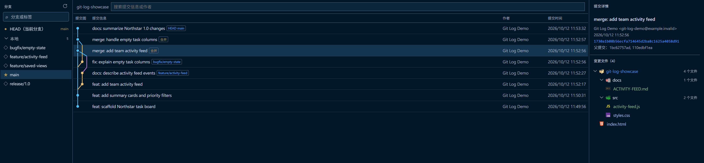

# IDEA Git Log

A small VS Code extension for browsing Git history in a three-pane layout:

- Local and remote branches on the left
- Searchable local, remote, and tag refs with upstream ahead/behind counts
- Commit graph with dynamically sized and compacted branch lanes, straight row-edge and merge connections, and ref labels in the middle
- Commit message and changed files on the right

The extension has no AI features. It uses the Git executable available on `PATH`.
Agent Host session checkpoint commits are excluded from the history view.
Click a changed file to open its diff against the commit's first parent in the editor.
Changed files are shown as a directory tree, with single-child directory chains compacted and descendant file counts; file names use status colors for added, modified, deleted, renamed, and conflicted files.
File and folder icons are loaded from the installed `vscode-icons` extension.
Branch icons and folder expand/collapse arrows use Microsoft Codicons from
`@vscode/codicons` under CC BY 4.0.

## Use

Open a Git repository in VS Code. **Git Log** appears by default in the Activity Bar
sidebar. To move it to the bottom panel, drag the **Git Log** view title and drop it
into the Panel. You can also run **Git Log: Open** from the Command Palette.

History opens on the current branch; select another branch in the left pane to switch
the history view. Local branches can be checked out when the working tree is clean;
remote branches are shown for browsing only. Install `vscode-icons` to provide file
and folder icons in the changed-files tree.

Right-click a local branch to **Pull**, **Push**, or **Update** (pull, then push).
If the branch is not currently checked out, Git Log switches to it first; switching
requires a clean working tree. Git errors are reported through VS Code notifications.
Conflicts are left for you to resolve with VS Code's Git tools.

## Development

Open this folder as a VS Code extension project and press `F5` to launch an
Extension Development Host. The command is also available as `ideaGitLog.open`.

## License

MIT
